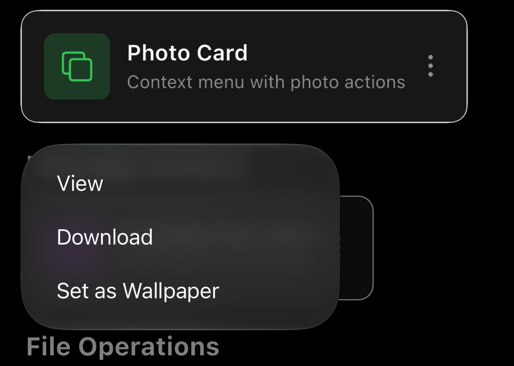
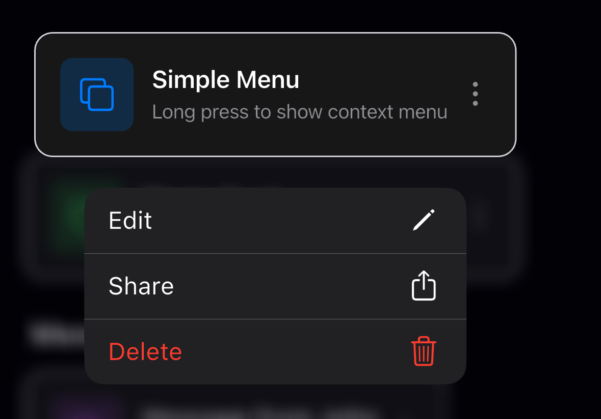
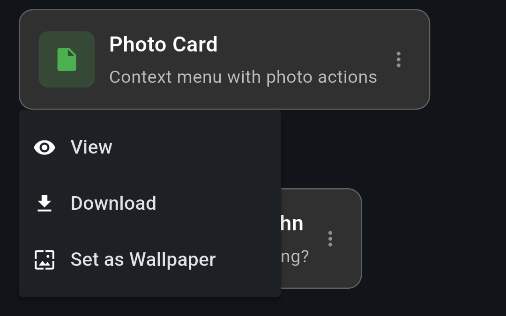

# Adaptive Platform UI

## Using this fork

The features under [New and fixed](#new-and-fixed) exist in this local fork, not in the `adaptive_platform_ui` release on pub.dev. This Forma project must consume its checked-in package through the root app's path dependency:

```yaml
dependencies:
  adaptive_platform_ui:
    path: packages/adaptive_platform_ui
```

Do not replace this project's dependency with a git or pub.dev dependency. Reusable changes belong in this directory. See the [native UI maintenance guide](../../docs/NATIVE_UI_GUIDE.md) for the implemented architecture, limitations, platform-specific usage, and audit procedure.

Requirements: Flutter 3.47 or later, and an iOS deployment target of 15.0 or later. Both Swift Package Manager and CocoaPods integrations work. With CocoaPods, run `pod install` in `ios/` after updating the dependency, because new Swift files are only picked up then.

## Native control rendering on iOS

On every supported iOS version, including iOS 18 and iOS 26, `AdaptiveButton`, `AdaptiveSwitch`, `AdaptiveSlider`, `AdaptiveSegmentedControl`, `AdaptivePopupMenuButton`, `AdaptiveContextMenu`, `AdaptiveAlertDialog`, `AdaptiveTextField` and `AdaptiveTextFormField` use UIKit controls through the package's platform-view bridge. The running OS supplies their appearance and interaction. The banking app uses these controls through the local path dependency; its content and callbacks remain in the app. Other exported widgets retain their documented implementations.

Native tab/navigation/search controllers inherit system appearance so Flutter can observe live brightness changes. The effective app theme is applied to the actual native bars and controls, rather than forcing the ancestor controllers into Flutter's previous appearance. This also permits explicit app light/dark themes without locking `ThemeMode.system`.

```dart
AdaptiveTextField(
  controller: emailController,
  placeholder: 'Email',
  keyboardType: TextInputType.emailAddress,
  autofillHints: const [AutofillHints.email],
  onChanged: updateEmail,
)
```

`AdaptiveTextField` uses `UITextField` for a single line and `UITextView` for multiple lines. It bridges controller text and selection, focus, input formatters and callbacks. `AdaptiveTextFormField` adds Flutter form validation and reset around the same native control. The new optional `AdaptiveTextField.autofillHints` parameter, and the existing form-field parameter, map common identity, address, password, one-time-code and card-number hints to UIKit's `textContentType`; the first hint is used on iOS. Unknown hints leave the content type unset. `UITextView` has no public visual placeholder API, so a multiline placeholder is retained as an accessibility label. Prefix/suffix widgets remain adjacent app content.

Compatibility details:

- `AdaptiveButton.useNative` remains accepted for source compatibility; setting it to `false` no longer selects a Flutter-drawn iOS button. UIKit owns highlighting, disabled appearance and press behavior.
- `glass` and `prominentGlass` use the corresponding native configurations on iOS 26+. Earlier iOS versions use existing UIKit `tinted` and `filled` configurations respectively; no glass appearance is simulated.
- Text-field `cupertinoDecoration` remains accepted but does not draw iOS chrome. UIKit supplies field borders and insets; Flutter decoration and padding options apply to the Material implementation.
- Multiline fields reserve the height specified by `minLines`, then `maxLines`, or four lines if neither is set. The native editor scrolls within that space rather than growing as text changes.
- Alerts use an unmodified `UIAlertController`, including its dimming and native cancel, destructive and preferred actions. Optional icon decorations and custom success/warning/info action colors are omitted because they have no supported native alert API. A one-time code is included in the normal message. Input alerts use the controller's native text field.

## Material components on Android

Android uses Flutter's standard Material widgets and the app's Material theme. The Android OS version does not select a different Material generation; `ThemeData.useMaterial3` and component themes control Material styling.

The hosting Android application enables `android:enableOnBackInvokedCallback="true"` for the supported Flutter predictive-Back integration. `AdaptiveNavigator` uses the normal `MaterialPageRoute`; Android recognizes its system gesture and Flutter renders the framework transition. A working Back key alone does not establish predictive cancellation/animation support. See the [Flutter setup guide](https://docs.flutter.dev/platform-integration/android/predictive-back).

`AdaptiveBottomNavigationBar.selectedItemColor` retains its Android meaning as the `NavigationBar` indicator color. A supplied color now also gets a contrasting inherited selected-icon color, avoiding an unreadable combination with Material's default `onSecondaryContainer`. Omit it to retain the full `NavigationBarTheme` defaults. An explicitly colored custom icon is responsible for its own contrast.

`AdaptiveNavigationSearchBar` uses a Material `AppBar`, `BackButton` and `SearchBar` on Android. Its text persists across widget rebuilds and detail-page push/pop while the page remains mounted. Clear sends an empty query through `onChanged`. Supply the widget in both platform slots when sharing a search page:

```dart
final searchBar = AdaptiveNavigationSearchBar(
  controller: searchController,
  title: 'Activity',
  onChanged: updateQuery,
  onBack: () => Navigator.of(context).maybePop(),
);

AdaptiveScaffold(
  appBar: AdaptiveAppBar(
    useNativeToolbar: false,
    cupertinoNavigationBar: searchBar,
    appBar: searchBar,
  ),
  body: AdaptiveListView(
    controller: searchController.scrollController,
    children: results,
  ),
)
```

The Material search header reports its complete toolbar and search-field height to `Scaffold`; it needs no additional top safe area. These controls are Flutter Material components rather than Android `View` platform bridges, so their appearance follows the Flutter SDK and theme on both older and newer Android releases.

## Native page navigation

Use `AdaptiveNavigator.push` for full-screen pages with native iOS navigation:

```dart
final result = await AdaptiveNavigator.push<String>(
  context,
  (_) => const DetailsPage(),
);

// On DetailsPage, the usual Navigator APIs preserve results and page state:
Navigator.of(context).pop('saved');
// A completed workflow can also return to its root:
Navigator.of(context).popUntil((route) => route.isFirst);
```

On iOS 15+, install `AdaptiveToolbarHost` (automatic with `AdaptiveApp`) and use `AdaptiveScaffold` on each page. Each pushed page gets a real UIKit content controller and navigation item. `UINavigationController` supplies the push/pop animation, native Back button and interactive back gesture, including cancellation. The incoming page publishes its native navigation item immediately, without the Flutter item crossfade used for tab changes. The Flutter route does not animate the page or install a competing back-swipe recognizer. A committed native pop updates Flutter only after UIKit completes; cancelling a swipe keeps the page, entered values and pending push result intact. Programmatic `pop` and `popUntil` synchronize the final native stack.

The app has one Flutter rendering surface. UIKit retains covered-page content snapshots and transfers the live Flutter surface between content controllers: before a native push starts, or after a native pop completes. Navigation bars, tab bars, native controls and their transition are supplied by UIKit; the package does not paint replicas of those controls into a custom transition.

Use `AdaptiveNavigator.push` consistently for every page above a native root. Arbitrary Flutter page routes, declarative router replacements and mixed unmanaged stacks do not get native content transitions automatically. This API supports a full-window navigation stack; independently visible nested stacks need their own native hosting integration. On Android and other non-iOS platforms the same API uses the standard `MaterialPageRoute` and leaves Material navigation behavior unchanged.

## New and fixed

Native navigation requires iOS 15+ and `AdaptiveToolbarHost` in your app's `builder`: `(context, child) => AdaptiveToolbarHost(child: child!)`.

The native tab and navigation controllers forward orientation preferences from the selected Flutter content. Applications retain control through `SystemChrome.setPreferredOrientations` and `Info.plist`; the package does not enable landscape on a portrait-only app.

The search destination uses UIKit's large navigation title on supported iOS versions, including iOS 18, 26 and 27. iOS 26+ uses `UINavigationItem.LargeTitleDisplayMode.inline` so the real navigation title remains visible during active search and scrolling; iOS 18 retains its native expanded title and top search field. On iOS 27, native bar minimization is also disabled. Focusing a search field preserves its navigation bar; opening a result completes search dismissal before transferring the bar to the detail page and its native Back button. Search text and filtered results survive a result's push navigation and return; the native Clear button resets the query before and after returning.

Known iOS 18.5 Search limitation: the large title is visible at first focus with the keyboard, but the compact title becomes hidden after scrolling while search remains active. The final audit reproduced that state in a bare UIKit reference with the same public search settings. This does not satisfy an unconditional always-visible-title requirement. No replacement header or private title-view mutation is used; the [guide](../../docs/NATIVE_UI_GUIDE.md#large-title-capability-and-per-item-mode-are-different) records the exact observation and comparison.

- **New: large-title UINavigationBar** — use `AdaptiveAppBar(title: 'Title', largeTitle: true, scrollController: controller)` in `AdaptiveScaffold.appBar`. Share one `AdaptiveNavigationScrollController` with the page's `AdaptiveListView`.
- **New: native navigation search** — set `AdaptiveAppBar(useNativeToolbar: false, cupertinoNavigationBar: AdaptiveNavigationSearchBar(...))`. Supply an `AdaptiveNavigationSearchController`, `title`, `onChanged`, and `onBack`; filter your content in `onChanged`.
- **New: expanding search tab** — set `AdaptiveBottomNavigationBar(search: AdaptiveTabSearch(placeholder: 'Search', onChanged: ...))` and add one `AdaptiveNavigationDestination(icon: 'magnifyingglass', label: 'Search', isSearch: true)`. Use `selectedIndex` and `onTap` to show results in the scaffold body; omit `appBar` on that destination. On iPhone with iOS 26+, native `UISearchTab` expands into a bottom search field above the keyboard and restores the previous tab on cancel. Use SF Symbol string icons and `AdaptiveListView` for automatic native insets. iOS 18 uses a native top search field in its search destination. Android keeps a regular destination; provide a Material search field in its body.
- **New: anchored action sheets** — call `AdaptiveActionSheet.show(anchorContext: buttonContext, title: 'Continue?', actions: [AdaptiveSheetAction('Continue')])`. Get the button/row context from a `Builder`. Returns the selected action index, or `null` on dismissal (a tap outside the sheet, or when another sheet is already open); it never throws. iOS uses a native action sheet, other platforms a bottom sheet.
- **New: half sheets** — call `AdaptiveBottomSheet.show(context: context, builder: (context) => ListView(...))` to show content in a modal sheet at half the screen height (`heightFactor`, default `0.5`). Returns the value passed to `Navigator.pop`, or `null` when dragged down or dismissed by a barrier tap. Native controls such as `AdaptiveSegmentedControl`, `AdaptiveSwitch`, `AdaptiveSlider` and `AdaptiveTextField` work inside it, and the sheet rises above the keyboard. Present a second sheet (for example a date picker) by calling `AdaptiveBottomSheet.show` with the first sheet's context; it stacks on top. While it is open, a native tab bar hides and hosted toolbar controls dim and go inert. iOS draws a floating iOS 26-style sheet inset from the screen edges with a grabber; other platforms use a Material modal bottom sheet with a drag handle. Limitation: the sheet is a Flutter route, not a `UISheetPresentationController`, so it has a single detent and its material is a solid `backgroundColor` (system background by default), not Liquid Glass. The page behind may change freely while the sheet is open: native controls of this package that end up behind a sheet are left out of the frame, because Flutter's iOS compositor would otherwise let them hide the sheet's text.
- **New: inline native date picker** — `AdaptiveInlineDatePicker(initialDate: d, firstDate: a, lastDate: b, onDateChanged: (d) {...})` embeds a date picker in your layout, for example in an `AdaptiveBottomSheet`. Give it a bounded height (`Expanded`). iOS uses a real `UIDatePicker` (`style: AdaptiveDatePickerStyle.wheels` or `.inline` calendar; `tintColor` for the selection), so the system draws and measures it; Flutter's `CupertinoDatePicker` clips its month and year columns on iOS 27. Other platforms show a Material `CalendarDatePicker`. Limitation: on iOS `initialDate` is applied when the view is created; rebuild with a new `key` to jump to another date.
- **New: custom fonts for native components** — call `AdaptiveNativeFonts.setFamily('Marker Felt')` to restyle the package's native iOS components live, or `setFamily(null)` for the system font. Applies to segmented control titles, button titles, text fields, the glass capsule's labels and badges, navigation bar titles (inline and large) and bar button titles, tab bar labels and search fields. The family must be installed on the device: one of the built-in iOS families (`await AdaptiveNativeFonts.availableFamilies()`), or a font bundled with the app and registered with iOS. `AdaptiveNativeFonts.family` is a `ValueNotifier` that changes once the native side has restyled; use it to give your Flutter theme the same `fontFamily`. Limitations: menus, context menus, action sheets, alerts and date pickers have no public font API and keep the system font; a wide face makes fixed-width buttons truncate their titles; the choice is not persisted.
- **Fix: dismissing native menus and action sheets with the search tab** — with `AdaptiveTabSearch` enabled, a tap outside an anchored action sheet or a toolbar `UIMenu` now closes it. Before, the sheet stayed open and blocked the screen.
- **New: scroll integration** — use `AdaptiveListView(controller: controller, children: [...])` with the same controller as `AdaptiveAppBar`. UIKit supplies the navigation inset; no extra top `SafeArea` or `AdaptiveLargeTitleSpacer` is needed. Keep controllers per page/tab and dispose them with the page.
- **Fix: UINavigationBar state and appearance** — the `AdaptiveAppBar` + `AdaptiveListView` setup above preserves native padding, title collapse, pull-down titles, and scroll state across tab switches and push/pop. Omit `largeTitle` for compact detail pages. Use a string `title` for native scroll integration.
- **Fix: first-visit tab jumping** — `AdaptiveScaffold` waits for the linked native navigation bar’s first inset before showing its body. Keep using `AdaptiveAppBar` + `AdaptiveListView` with the same controller; no fixed height or delay is needed.
- **Fix: full-size Liquid Glass UITabBar** — use `AdaptiveScaffold(bottomNavigationBar: AdaptiveBottomNavigationBar(...))` with `useNativeBottomBar: true` (the default). The native tab bar stays full size; no extra workaround is required.
- **Fix: search and underlying controls** — `AdaptiveTabSearch` keeps its native search field and close button interactive while passing page touches to buttons, segmented controls, switches, and sliders. `AdaptiveActionSheet` and slider-driven progress updates need no app workaround.
- **Fix: search tab title** — the search destination's large title collapses as its `AdaptiveListView` scrolls, and the collapsed bar shows the inline title and scroll-edge effect like an `AdaptiveAppBar(largeTitle: true)` page. Content starts below the expanded title. No controller is needed: the body's visible vertical scroll view drives the bar. Switching to or from the search tab changes the title area in a single frame, with no overlap or fade from the previous page's title.
- **Fix: content behind the tab bar** — native tab-bar layout supplies `MediaQuery.padding.bottom` automatically. `AdaptiveListView` and a default `ListView` use it; remove manual bottom spacers. For a custom scroll view or `ListView` with explicit padding, use `SliverSafeArea` or `SafeArea` to consume that inset. Hidden bars reserve no tab-bar space.
- **Fix: navigation search layout and glass** — use `AdaptiveListView(controller: searchController.scrollController, children: [...])` with your `AdaptiveNavigationSearchController`. The header uses UIKit's scroll-edge effect over the content, native sizing, and matching keyboard colors. Dispose the search controller; it owns the scroll controller.
- **Fix: native navigation menus** — add `AdaptiveAppBarAction(iosSymbol: 'ellipsis', label: 'Options', menuItems: [...], onMenuItemSelected: ...)` to `AdaptiveAppBar.actions`. Use `AdaptivePopupMenuItem(selected: true, ...)` for checkmarks and `AdaptivePopupMenuDivider()` for groups; rebuild with the updated selection after a choice. iOS 26+ presents a native `UIMenu`.

[](https://github.com/berkaycatak/adaptive_platform_ui/actions)
[](https://github.com/berkaycatak/adaptive_platform_ui/releases)
[](https://opensource.org/licenses/MIT)
[](https://flutter.dev)

A Flutter package with UIKit navigation and controls on supported iOS versions and Material widgets on Android. UIKit selects the appearance for the running OS. See the native-control coverage and limitations above.

> **Upgrading from 0.1.x?** Read [Migrating to 1.0.0](#migrating-to-100) first: the iOS deployment target is now 15.0. Use [Native page navigation](#native-page-navigation) for UIKit-owned push/pop transitions.

## Contents

- [Native control rendering on iOS](#native-control-rendering-on-ios)
- [Material components on Android](#material-components-on-android)
- [Native page navigation](#native-page-navigation)
- [New and fixed](#new-and-fixed)
- [iPhone Liquid Glass coverage audit](#iphone-liquid-glass-coverage-audit)
- **[Migrating to 1.0.0](#migrating-to-100)**
- [Installation](#installation)
- [Quick Start](#quick-start)
- [Fixed Liquid Glass Toolbar, iPhone Duo Ready](#fixed-liquid-glass-toolbar-iphone-duo-ready)
- [iOS 26+ Native Toolbar & Tab Bar](#ios-26-native-toolbar--tab-bar)
- [Features](#features)
- [Widget Showcase](#widget-showcase)
- [Usage](#usage)
- [Platform Detection](#platform-detection)
- [iOS 26 Native Features](#ios-26-native-features)
- [Widget Catalog](#widget-catalog)
- [iOS Version Support](#ios-version-support)
- [Requirements](#requirements)
- [Contributing](#contributing)

  

## Fixed Liquid Glass Toolbar, iPhone Duo Ready

<p align="center">
  
</p>
<p align="center">
  
</p>

UIKit owns the navigation bars and tab bars. With `AdaptiveNavigator.push`, its navigation controller also owns content transitions and the interactive back swipe. On iPhone Duo, the system places the navigation and tab controls in its vertical bar; overflowing actions use the system menu. See [Native page navigation](#native-page-navigation) for the required push API and router limitations.

## iOS 26+ Native Toolbar & Tab Bar

  

Native iOS 26+ UINavigationBar and UITabBar with Liquid Glass and native gesture handling. The tab bar stays full size.

## Features

**AdaptiveApp** - Unified app configuration for all platforms:
- Separate themes for Material (Android) and Cupertino (iOS)
- Full theme mode support (light, dark, system)
- Router support via `AdaptiveApp.router()`
- Zero configuration required

**iOS 26+ Native Designs** - Modern iOS 26 components with:
- **Native UINavigationBar** - Liquid Glass navigation bar with native titles and scrolling
- **Native UITabBar** - Full-size Liquid Glass tab bar with native interaction
- **Native UIButton** - System configurations and native press behavior
- **Native UISegmentedControl** - Segmented controls with SF Symbol support
- **Native UISwitch & UISlider** - Switches and sliders with native animations
- Native corner radius and shadows
- Smooth spring animations
- Dynamic color system (light/dark mode)
- Multiple component styles

**iOS 18 support** - UIKit navigation and the controls listed in Native control rendering on iOS

**Material Design** - Full Material 3 support for Android

**Automatic Platform Detection** - Zero configuration required

**Version-Aware Rendering** - Automatically selects appropriate widget based on iOS version

## Widget Showcase

### Important: Localization Setup

⚠️ **For proper localization support (automatic translations for date/time pickers, buttons, etc.), you must add localization delegates to your `AdaptiveApp`:**

```dart
import 'package:flutter_localizations/flutter_localizations.dart';

AdaptiveApp(
  localizationsDelegates: [
    GlobalMaterialLocalizations.delegate,
    GlobalCupertinoLocalizations.delegate, // Important!
    GlobalWidgetsLocalizations.delegate,
  ],
  supportedLocales: [
    Locale('en', ''), // English
    Locale('de', ''), // German
    Locale('tr', ''), // Turkish
    // Add more locales as needed
  ],
  // ... rest of your app configuration
)
```

Without these delegates, date/time pickers and other widgets will show English text regardless of system language.

### AdaptiveScaffold with AdaptiveAppBar


**Basic Usage:**
```dart
AdaptiveScaffold(
  appBar: AdaptiveAppBar(
    title: 'My App',
    actions: [
      AdaptiveAppBarAction(
        onPressed: () {},
        iosSymbol: 'gear',
        icon: Icons.settings,
      ),
    ],
  ),
  bottomNavigationBar: AdaptiveBottomNavigationBar(
    items: [
      AdaptiveNavigationDestination(
        icon: 'house.fill',
        label: 'Home',
      ),
      AdaptiveNavigationDestination(
        icon: 'person.fill',
        label: 'Profile',
      ),
    ],
    selectedIndex: 0,
    onTap: (index) {},
  ),
  body: YourContent(),
)
```

**iOS 26 Native Toolbar:**
```dart
AdaptiveScaffold(
  appBar: AdaptiveAppBar(
    title: 'My App',
    useNativeToolbar: true, // Enable native iOS 26 UIToolbar with Liquid Glass effects
    actions: [...],
  ),
  body: YourContent(),
)
```

**iOS 26 Native Bottom Bar:**
```dart
AdaptiveScaffold(
  bottomNavigationBar: AdaptiveBottomNavigationBar(
    useNativeBottomBar: true, // Enable native iOS 26 UITabBar with Liquid Glass effects (default)
    items: [...],
    selectedIndex: 0,
    onTap: (index) {},
  ),
  body: YourContent(),
)
```
**Toolbar menu:**

Give an action `menuItems` instead of `onPressed` and tapping it opens a menu,
like the "more" button of a system app. On iOS 26+ it is a native `UIMenu`
shown at the bar button; on iOS <26 an action sheet; on Android a popup menu
at the button.

```dart
AdaptiveAppBarAction(
  iosSymbol: 'ellipsis',
  icon: Icons.more_horiz,
  label: 'More',
  menuItems: const [
    AdaptivePopupMenuItem(label: 'Share', icon: 'square.and.arrow.up'),
    AdaptivePopupMenuItem(label: 'Hide', icon: 'eye.slash'),
    AdaptivePopupMenuDivider(),
    AdaptivePopupMenuItem(label: 'Delete', icon: 'trash', isDestructive: true),
  ],
  onMenuItemSelected: (index, item) => handle(item.label),
)
```

`index` is the entry's position in `menuItems`, dividers included. When an
entry changes, e.g. "Hide" turning into "Show", the bar picks it up on the
next build.

**No AppBar or Bottom Navigation:**
```dart
// If appBar and bottomNavigationBar are null, neither will be shown
AdaptiveScaffold(
  body: YourContent(),
)
```

**Key Features:**
- 🎨 **AdaptiveAppBar**: Centralized app bar configuration
- 📱 **AdaptiveBottomNavigationBar**: Centralized bottom navigation configuration
- 🔧 **Custom Navigation Bars**: Provide your own navigation components
- 🌟 **Native iOS 26 Components**: Optional Liquid Glass effects with native UIKit
- 🎯 **Priority System**: Custom bars take priority over auto-generated ones
- 🔄 **Flexible**: Null parameters hide components

Adaptive Bottom Navigation Bar (Destinations):
<p align="center">
  
</p>


### Fixed Liquid Glass toolbar and iPhone Duo

On supported iOS versions, `AdaptiveApp` hosts native navigation controls.
Use `AdaptiveNavigator.push` so the real `UINavigationController` also owns
the content transition and interactive back navigation.

- **Page configuration.** Use `AdaptiveApp` and give
  your pages an `AdaptiveAppBar(useNativeToolbar: true)`. Each
  `AdaptiveScaffold` publishes its app bar when it appears and withdraws it
  when it leaves.
- **Push navigation.** Use `AdaptiveNavigator.push`; ordinary `Navigator.pop`
  and `popUntil` then synchronize the native stack. See the native navigation
  section for limits when using declarative routers or nested stacks.
- **Native transitions.** UIKit animates the content controllers and navigation
  items together. Cancelling a native back swipe restores the current page;
  a completed swipe pops the matching Flutter route after UIKit commits.
- **Dialogs and sheets** leave the bar in place, dimmed and not tappable.
- **iPhone Duo (iOS 27.1+, Xcode 27.1 SDK).** A real Swift `UINavigationController` now
  renders the navigation title and `UINavigationItem` actions in the system's
  vertical bar. Set `AdaptiveAppBar(largeTitle: true, scrollController: scroll)`
  with a plain string title and use the same `AdaptiveNavigationScrollController`
  on `AdaptiveListView`. UIKit owns title typography, placement, scroll-edge
  appearance, action menus, and safe-area geometry; no Flutter title replica is
  used on iOS. Native bar minimization is disabled for vertical navigation so
  the current title stays visible while scrolling. Normal iPhones retain their
  native large-to-inline title collapse and top-right actions.
  `AdaptiveTabSearch` keeps its native `UITabBarController` side controls.
  The Swift bridge reports its title and control rectangles to Flutter, which
  clips the full-window platform view to those rectangles so content taps and
  scrolling still reach the page. Inside those rectangles, hit testing is opaque
  so the underlying tab/search platform view cannot steal navigation or menu
  gestures. Rotation remeasures native geometry.
  Native search headers also measure side controls so Duo’s back button is not clipped.
  Applications must enable landscape in `Info.plist` and their orientation
  policy; the package does not override application orientation restrictions.
  Compose wide content with `LayoutBuilder` using the width after safe-area
  insets, and keep narrow/large-text layouts single-column.
  Custom `titleWidget`/subtitle overlays and custom leading widgets remain
  caller-owned Flutter content; use a plain `title` and native actions for the
  system presentation. Native verification requires a simulator/device; widget
  tests use the non-iOS fallback. `IOS26NativeToolbar.verticalNavigation` is the
  low-level full-window bridge flag used by the host and standalone scaffold;
  `IOS26Scaffold.largeTitle` and `scrollController` forward the same native title
  and scroll behavior for standalone scaffolds. Callers should normally use
  `AdaptiveAppBar` instead.
- **Overflow.** When the strip runs out of room, toolbar items move, from the
  bottom up, into the system overflow menu, and the tab bar stays whole.
  Give every icon action a `label` so it has a name there:

```dart
AdaptiveAppBarAction(
  iosSymbol: 'arrow.uturn.backward',
  icon: Icons.undo,
  label: 'Undo', // overflow menu, VoiceOver, Android tooltip
  onPressed: undo,
)
```

  Unlike `title`, a `label` never replaces the icon with text.
- **Badges.** A toolbar item in the strip can carry a count, drawn in the
  same red badge as the tabs ("99+" above 99). iOS 18 and Android draw it on
  the icon; the horizontal iOS 26 toolbar ignores it:

```dart
AdaptiveAppBarAction(
  iosSymbol: 'bell',
  label: 'Notifications',
  badgeCount: unreadCount, // null or 0: no badge
  onPressed: openNotifications,
)
```

Not using `AdaptiveApp`? Install the host yourself, around the navigator
(see [Migrating to 1.0.0](#migrating-to-100)):

```dart
MaterialApp(
  builder: (context, child) => AdaptiveToolbarHost(child: child!),
  // ...
);
```

Without a host every page draws its own toolbar, as before.


### AdaptiveButton


```dart
// Basic button with label
AdaptiveButton(
  onPressed: () {},
  label: 'Click Me',
)

// Button with custom child
AdaptiveButton.child(
  onPressed: () {},
  child: Row(
    children: [
      Icon(Icons.add),
      Text('Add Item'),
    ],
  ),
)

// Icon button
AdaptiveButton.icon(
  onPressed: () {},
  icon: Icons.favorite,
)

// Fully circular icon button: a square box plus a capsule corner style
// (useSmoothRectangleBorder: false) on iOS 26, borderRadius elsewhere
SizedBox(
  width: 44,
  height: 44,
  child: AdaptiveButton.sfSymbol(
    onPressed: () {},
    sfSymbol: const SFSymbol('plus', size: 20),
    useSmoothRectangleBorder: false,
    borderRadius: BorderRadius.circular(22),
  ),
)
```

### AdaptiveAlertDialog


```dart
// Basic alert dialog
AdaptiveAlertDialog.show(
  context: context,
  title: 'Confirm',
  message: 'Are you sure?',
  icon: 'checkmark.circle.fill',
  actions: [
    AlertAction(
      title: 'Cancel',
      style: AlertActionStyle.cancel,
      onPressed: () {},
    ),
    AlertAction(
      title: 'Confirm',
      style: AlertActionStyle.primary,
      onPressed: () {
        // Do something
      },
    ),
  ],
);

// Alert dialog with text input
final result = await AdaptiveAlertDialog.inputShow(
  context: context,
  title: 'Enter Your Name',
  message: 'Please provide your name',
  icon: 'person.fill',
  input: AdaptiveAlertDialogInput(
    placeholder: 'Your name',
    initialValue: '',
    keyboardType: TextInputType.text,
  ),
  actions: [
    AlertAction(
      title: 'Cancel',
      style: AlertActionStyle.cancel,
      onPressed: () {},
    ),
    AlertAction(
      title: 'Submit',
      style: AlertActionStyle.primary,
      onPressed: () {},
    ),
  ],
);

// result contains the text entered by the user
if (result != null) {
  print('User entered: $result');
}
```

### AdaptiveContextMenu

<p align="center">
  
  
  
</p>

```dart
AdaptiveContextMenu(
  actions: [
    AdaptiveContextMenuAction(
      title: 'Edit',
      icon: PlatformInfo.isIOS ? CupertinoIcons.pencil : Icons.edit,
      onPressed: () {
        print('Edit pressed');
      },
    ),
    AdaptiveContextMenuAction(
      title: 'Share',
      icon: PlatformInfo.isIOS ? CupertinoIcons.share : Icons.share,
      onPressed: () {
        print('Share pressed');
      },
    ),
    AdaptiveContextMenuAction(
      title: 'Delete',
      icon: PlatformInfo.isIOS ? CupertinoIcons.trash : Icons.delete,
      isDestructive: true,
      onPressed: () {
        print('Delete pressed');
      },
    ),
  ],
  child: Container(
    padding: EdgeInsets.all(16),
    child: Text('Long press me'),
  ),
)
```

**iOS 26+**: Native context menu with Liquid Glass.
**iOS**: Uses `UIContextMenuInteraction` with system previews and actions.
**Android**: Uses `PopupMenuButton` with Material Design styling.

### AdaptivePopupMenuButton

<p align="center">

</p>

```dart
// Text button with popup menu
AdaptivePopupMenuButton.text<String>(
  label: 'Options',
  items: [
    AdaptivePopupMenuItem(
        label: 'Edit',
        icon:  PlatformInfo.isIOS26OrHigher() ?  'pencil' : Icons.edit,
        value: 'edit',
      ),
      AdaptivePopupMenuItem(
        label: 'Delete',
        icon: PlatformInfo.isIOS26OrHigher() ?  'trash' : Icons.delete,
        value: 'delete',
      ),
      AdaptivePopupMenuDivider(),
      AdaptivePopupMenuItem(
        label: 'Share',
        icon: PlatformInfo.isIOS26OrHigher() ? 'square.and.arrow.up' : Icons.share,
        value: 'share',
      ),
  ],
  onSelected: (index, item) {
    print('Selected: ${item.value}');
  },
)

// Icon button with popup menu
AdaptivePopupMenuButton.icon<String>(
  icon: 'ellipsis.circle',
  iconSize: 28, // glyph size; the button stays `size` wide
  items: [...],
  onSelected: (index, item) { },
  buttonStyle: PopupButtonStyle.glass,
)

// Custom widget with popup menu
AdaptivePopupMenuButton.widget<String>(
  items: [
    AdaptivePopupMenuItem(label: 'Option 1', value: 'opt1'),
    AdaptivePopupMenuItem(label: 'Option 2', value: 'opt2'),
  ],
  onSelected: (index, item) {
    print('Selected: ${item.value}');
  },
  child: Container(
    padding: EdgeInsets.symmetric(horizontal: 12, vertical: 8),
    decoration: BoxDecoration(
      color: Colors.blue.withOpacity(0.1),
      borderRadius: BorderRadius.circular(8),
    ),
    child: Row(
      mainAxisSize: MainAxisSize.min,
      children: [
        Icon(Icons.menu),
        SizedBox(width: 8),
        Text('Custom Button'),
      ],
    ),
  ),
)

// Single-select menu — mark the current value with `selected: true`.
// iOS 14+ native menus show the system trailing checkmark; Material menus and
// the iOS <26 action-sheet fallback show a leading checkmark.
AdaptivePopupMenuButton.text<String>(
  label: currentValue,
  items: [
    for (final option in options)
      AdaptivePopupMenuItem(
        label: option,
        value: option,
        selected: option == currentValue,
      ),
  ],
  onSelected: (index, item) => setState(() => currentValue = item.value!),
)
```

### AdaptiveSegmentedControl

<p align="center">
  
</p>

```dart
AdaptiveSegmentedControl(
  labels: ['One', 'Two', 'Three'],
  selectedIndex: 0,
  onValueChanged: (index) {
    print('Selected: $index');
  },
)

// With icons (SF Symbols on iOS)
AdaptiveSegmentedControl(
  labels: [],
  sfSymbols: [
    'house.fill',
    'person.fill',
    'gear',
  ],
  selectedIndex: 0,
  onValueChanged: (index) {},
  iconColor: CupertinoColors.systemBlue,
)
```

### AdaptiveSwitch

<p align="center">
  
</p>

```dart
AdaptiveSwitch(
  value: true,
  onChanged: (value) {
    print('Switch: $value');
  },
)
```

### AdaptiveSlider

<p align="center">
  
</p>

```dart
AdaptiveSlider(
  value: 0.5,
  onChanged: (value) {
    print('Slider: $value');
  },
  min: 0.0,
  max: 1.0,
)
```

### AdaptiveCheckbox

```dart
AdaptiveCheckbox(
  value: true,
  onChanged: (value) {
    print('Checkbox: $value');
  },
)

// Tristate checkbox
AdaptiveCheckbox(
  value: null, // Can be true, false, or null
  tristate: true,
  onChanged: (value) {
    print('Checkbox: $value');
  },
)
```

### AdaptiveRadio

```dart
enum Options { option1, option2, option3 }
Options? _selectedOption = Options.option1;

AdaptiveRadio<Options>(
  value: Options.option1,
  groupValue: _selectedOption,
  onChanged: (Options? value) {
    setState(() {
      _selectedOption = value;
    });
  },
)
```

### AdaptiveCard

```dart
AdaptiveCard(
  padding: EdgeInsets.all(16),
  child: Text('Card Content'),
)

// Card with custom styling
AdaptiveCard(
  padding: EdgeInsets.all(16),
  color: Colors.blue.withValues(alpha: 0.1),
  borderRadius: BorderRadius.circular(20),
  elevation: 8, // Android only
  child: Column(
    children: [
      Text('Custom Card'),
      Text('With multiple elements'),
    ],
  ),
)
```

### AdaptiveBadge

```dart
AdaptiveBadge(
  count: 5,
  child: Icon(Icons.notifications),
)

// Badge with text label
AdaptiveBadge(
  label: 'NEW',
  backgroundColor: Colors.red,
  child: Icon(Icons.mail),
)

// Large badge
AdaptiveBadge(
  count: 99,
  isLarge: true,
  child: Icon(Icons.message),
)
```

### AdaptiveTooltip

```dart
AdaptiveTooltip(
  message: 'This is a tooltip',
  child: Icon(Icons.info),
)

// Tooltip positioned above
AdaptiveTooltip(
  message: 'Tooltip appears above',
  preferBelow: false,
  child: Icon(Icons.help),
)
```

### AdaptiveSnackBar

```dart
// Basic snackbar
AdaptiveSnackBar.show(
  context,
  message: 'Operation completed successfully!',
  type: AdaptiveSnackBarType.success,
)

// Snackbar with action button
AdaptiveSnackBar.show(
  context,
  message: 'File deleted',
  type: AdaptiveSnackBarType.info,
  action: 'Undo',
  onActionPressed: () {
    // Undo action
  },
)

// Custom duration
AdaptiveSnackBar.show(
  context,
  message: 'This will stay longer',
  duration: Duration(seconds: 8),
)

// Different types
AdaptiveSnackBar.show(context, message: 'Info', type: AdaptiveSnackBarType.info);
AdaptiveSnackBar.show(context, message: 'Success', type: AdaptiveSnackBarType.success);
AdaptiveSnackBar.show(context, message: 'Warning', type: AdaptiveSnackBarType.warning);
AdaptiveSnackBar.show(context, message: 'Error', type: AdaptiveSnackBarType.error);
```

**iOS**: Banner-style notification at the top with slide/fade animations, tap to dismiss, and icon indicators.
**Android**: Material SnackBar at the bottom with standard Material Design appearance.

### AdaptiveDatePicker

```dart
// Basic date picker
final selectedDate = await AdaptiveDatePicker.show(
  context: context,
  initialDate: DateTime.now(),
);

// Date picker with range
final selectedDate = await AdaptiveDatePicker.show(
  context: context,
  initialDate: DateTime.now(),
  firstDate: DateTime(2020),
  lastDate: DateTime(2025),
);

// Date and time picker (iOS)
final selectedDateTime = await AdaptiveDatePicker.show(
  context: context,
  initialDate: DateTime.now(),
  mode: CupertinoDatePickerMode.dateAndTime,
);

if (selectedDate != null) {
  print('Selected: ${selectedDate.toString()}');
}
```

**iOS**: Uses `CupertinoDatePicker` in a modal bottom sheet with Cancel/Done buttons.
**Android**: Uses Material `DatePickerDialog`.

### AdaptiveTimePicker

```dart
// 12-hour format
final selectedTime = await AdaptiveTimePicker.show(
  context: context,
  initialTime: TimeOfDay.now(),
  use24HourFormat: false,
);

// 24-hour format
final selectedTime = await AdaptiveTimePicker.show(
  context: context,
  initialTime: TimeOfDay.now(),
  use24HourFormat: true,
);

if (selectedTime != null) {
  print('Selected: ${selectedTime.format(context)}');
}
```

**iOS**: Uses `CupertinoDatePicker` in time mode in a modal bottom sheet.
**Android**: Uses Material `TimePickerDialog`.

### AdaptiveListTile

```dart
// Basic list tile
AdaptiveListTile(
  title: Text('Profile'),
  subtitle: Text('View your profile'),
  hideBottomDivider: false, // Hide bottom border, useful for last item (iOS only)
  onTap: () {
    // Handle tap
  },
)

// List tile with leading and trailing
AdaptiveListTile(
  leading: Icon(Icons.person),
  title: Text('Profile'),
  subtitle: Text('View your profile'),
  trailing: Icon(Icons.chevron_right),
  onTap: () {
    // Handle tap
  },
)

// Selectable list tile
AdaptiveListTile(
  leading: Icon(Icons.star),
  title: Text('Favorite'),
  selected: true,
  trailing: Icon(Icons.check_circle),
  onTap: () {
    // Handle tap
  },
)

// List tile with custom trailing widget
AdaptiveListTile(
  title: Text('Enable Feature'),
  subtitle: Text('Toggle to enable'),
  trailing: AdaptiveSwitch(
    value: switchValue,
    onChanged: (value) {
      // Handle change
    },
  ),
)
```

**iOS**: Uses CupertinoListTile-like styling with bottom border separator.
**Android**: Uses Material `ListTile`.

### AdaptiveTextField

```dart
// Basic text field
AdaptiveTextField(
  placeholder: 'Enter your name',
  onChanged: (value) {
    print('Text: $value');
  },
)

// Text field with icons
AdaptiveTextField(
  placeholder: 'Search',
  prefixIcon: Icon(
    PlatformInfo.isIOS ? CupertinoIcons.search : Icons.search,
  ),
  suffixIcon: IconButton(
    icon: Icon(
      PlatformInfo.isIOS ? CupertinoIcons.clear : Icons.clear,
    ),
    onPressed: () {
      // Clear text
    },
  ),
)

// Password field
AdaptiveTextField(
  placeholder: 'Enter password',
  obscureText: true,
  prefixIcon: Icon(
    PlatformInfo.isIOS ? CupertinoIcons.lock : Icons.lock,
  ),
)

// Multiline text field
AdaptiveTextField(
  placeholder: 'Enter description',
  maxLines: 5,
  minLines: 3,
  keyboardType: TextInputType.multiline,
)
```

**iOS**: Uses `UITextField` or `UITextView`; UIKit owns text selection, keyboard and field appearance.
**Android**: Uses Material `TextField` with outlined border.

### AdaptiveTextFormField

```dart
// Form with validation
Form(
  key: _formKey,
  child: Column(
    children: [
      AdaptiveTextFormField(
        placeholder: 'Email',
        keyboardType: TextInputType.emailAddress,
        validator: (value) {
          if (value == null || value.isEmpty) {
            return 'Please enter your email';
          }
          if (!value.contains('@')) {
            return 'Please enter a valid email';
          }
          return null;
        },
        onSaved: (value) => _email = value,
      ),
      AdaptiveButton(
        onPressed: () {
          if (_formKey.currentState!.validate()) {
            _formKey.currentState!.save();
            // Process form
          }
        },
        label: 'Submit',
      ),
    ],
  ),
)
```

**iOS**: Uses the native text-field bridge inside a Flutter `FormField` for validation and reset.
**Android**: Uses Material `TextFormField`.

### AdaptiveFloatingActionButton

```dart
// Basic floating action button
AdaptiveFloatingActionButton(
  onPressed: () {},
  child: Icon(Icons.add),
)

// Mini FAB
AdaptiveFloatingActionButton(
  onPressed: () {},
  mini: true,
  child: Icon(Icons.edit),
)

// Custom colors
AdaptiveFloatingActionButton(
  onPressed: () {},
  backgroundColor: Colors.red,
  foregroundColor: Colors.white,
  child: Icon(Icons.favorite),
)
```

**iOS**: Circular button with custom shadow effects.
**Android**: Material `FloatingActionButton` with elevation.

### AdaptiveFormSection

```dart
// Basic form section
AdaptiveFormSection(
  header: Text('Personal Information'),
  footer: Text('Please provide accurate information'),
  children: [
    CupertinoFormRow(
      prefix: Text('Name'),
      child: AdaptiveTextField(placeholder: 'Enter name'),
    ),
    CupertinoFormRow(
      prefix: Text('Email'),
      child: AdaptiveTextField(placeholder: 'Enter email'),
    ),
  ],
)

// Inset grouped style
AdaptiveFormSection.insetGrouped(
  header: Text('Settings'),
  children: [
    CupertinoFormRow(
      prefix: Text('Notifications'),
      child: AdaptiveSwitch(value: true, onChanged: (v) {}),
    ),
  ],
)
```

**iOS**: Uses `CupertinoFormSection` with native iOS styling.
**Android**: Uses Material `Card` with similar grouped layout.

### AdaptiveExpansionTile

```dart
// Basic expansion tile
AdaptiveExpansionTile(
  title: Text('Settings'),
  children: [
    ListTile(title: Text('Option 1')),
    ListTile(title: Text('Option 2')),
  ],
)

// With leading and subtitle
AdaptiveExpansionTile(
  leading: Icon(Icons.settings),
  title: Text('Advanced Settings'),
  subtitle: Text('Configure advanced options'),
  initiallyExpanded: true,
  children: [
    ListTile(title: Text('Option 1')),
    ListTile(title: Text('Option 2')),
  ],
)

// With custom colors
AdaptiveExpansionTile(
  title: Text('Premium Features'),
  backgroundColor: Colors.amber.withValues(alpha: 0.1),
  iconColor: Colors.amber,
  onExpansionChanged: (expanded) {
    print('Expanded: $expanded');
  },
  children: [
    ListTile(title: Text('Feature 1')),
    ListTile(title: Text('Feature 2')),
  ],
)
```

**iOS**: Modern custom design with rounded corners, smooth shadows, animated chevron, and gradient separator.
**Android**: Material `ExpansionTile` with InkWell effects.

### AdaptiveTabBarView

Horizontal swipeable tab view with tabs at the top.

```dart
// Tab bar view at the top
AdaptiveTabBarView(
  tabs: ['Latest', 'Popular', 'Trending'],
  children: [
    LatestPage(),
    PopularPage(),
    TrendingPage(),
  ],
  onTabChanged: (index) {
    print('Tab changed to: $index');
  },
)
```

**iOS**: Uses `UISegmentedControl` for selection and system sizing.
**Android**: Uses Material `TabBar` + `TabBarView`.

## Usage

### Button Styles

```dart
// Filled button (primary action)
AdaptiveButton(
  onPressed: () {},
  style: AdaptiveButtonStyle.filled,
  label: 'Filled',
)

// Tinted button (secondary action)
AdaptiveButton(
  onPressed: () {},
  style: AdaptiveButtonStyle.tinted,
  label: 'Tinted',
)

// Gray button (neutral action)
AdaptiveButton(
  onPressed: () {},
  style: AdaptiveButtonStyle.gray,
  label: 'Gray',
)

// Bordered button
AdaptiveButton(
  onPressed: () {},
  style: AdaptiveButtonStyle.bordered,
  label: 'Bordered',
)

// Plain text button
AdaptiveButton(
  onPressed: () {},
  style: AdaptiveButtonStyle.plain,
  label: 'Plain',
)
```

### Button Sizes

```dart
// Small button (28pt height on iOS)
AdaptiveButton(
  onPressed: () {},
  size: AdaptiveButtonSize.small,
  label: 'Small',
)

// Medium button (36pt height on iOS) - default
AdaptiveButton(
  onPressed: () {},
  size: AdaptiveButtonSize.medium,
  label: 'Medium',
)

// Large button (44pt height on iOS)
AdaptiveButton(
  onPressed: () {},
  size: AdaptiveButtonSize.large,
  label: 'Large',
)
```

### Custom Styling

```dart
AdaptiveButton(
  onPressed: () {},
  label: 'Custom Button',
  color: Colors.red,
  padding: EdgeInsets.symmetric(horizontal: 24, vertical: 12),
  borderRadius: BorderRadius.circular(16),
  minSize: Size(200, 50),
)
```

### Disabled State

```dart
AdaptiveButton(
  onPressed: () {},
  label: 'Disabled',
  enabled: false,
)
```

## Platform Detection

Use the `PlatformInfo` utility class to check platform and iOS version:

```dart
import 'package:adaptive_platform_ui/adaptive_platform_ui.dart';

// Check platform
if (PlatformInfo.isIOS) {
  print('Running on iOS');
}

if (PlatformInfo.isAndroid) {
  print('Running on Android');
}

// Check iOS version
if (PlatformInfo.isIOS26OrHigher()) {
  print('Using iOS 26+ features');
}

if (PlatformInfo.isIOS18OrLower()) {
  print('Using legacy iOS widgets');
}

// Get iOS version number
int version = PlatformInfo.iOSVersion; // e.g., 26

// Check version range
if (PlatformInfo.isIOSVersionInRange(24, 26)) {
  print('iOS version is between 24 and 26');
}

// Get platform description
String description = PlatformInfo.platformDescription; // e.g., "iOS 26"
```

## Installation

Add this to your package's `pubspec.yaml` file. The pub.dev release does not include this fork's additions; see [Using this fork](#using-this-fork) to depend on the repository instead:

```yaml
dependencies:
  adaptive_platform_ui: ^1.0.0
```

Then run:

```bash
flutter pub get
```

iOS needs a deployment target of 15.0 or higher. In `ios/Podfile`:

```ruby
platform :ios, '15.0'
```

## Migrating to 1.0.0

Most apps need two small steps, or none.

**1. Raise the iOS deployment target to 15.0.** Set `platform :ios, '15.0'` in
`ios/Podfile`, set the Runner target's iOS Deployment Target to 15.0 in Xcode,
then run `pod install`. Xcode 27 does not build below 15.0.

**2. Let the fixed toolbar in.** On iOS 26+ the native toolbar now lives above
the navigator instead of inside each page.

- If you use `AdaptiveApp` or `AdaptiveApp.router`, there is nothing to do.
- If you use `MaterialApp` or `CupertinoApp` directly, add the host once:

```dart
MaterialApp(
  builder: (context, child) => AdaptiveToolbarHost(child: child!),
  // ...
);
```

Without the host every page keeps drawing its own toolbar, exactly as before
1.0.0, so nothing breaks; you just do not get the fixed toolbar, and on iPhone
Duo the tab bar of a tab layout stays at the bottom instead of moving into
the vertical bar.

**Check these if they apply to you:**

- **Custom `leading`, `titleWidget` or `iconWidget`.** They are now built above
  the navigator. A widget that calls `Navigator.of(context)` with *its own*
  context no longer finds the page's navigator. Use the page's context:

```dart
// Before: a widget that looks the navigator up from its own context.
leading: const MyCloseButton(),

// After: capture the page's context in the callback.
leading: CupertinoButton(
  onPressed: () => Navigator.of(context).pop(), // the page's context
  child: const Icon(CupertinoIcons.xmark),
),
```

- **A scaffold that does not start at the top of the screen**, such as one
  pane of a side by side layout, should keep its own toolbar:

```dart
AdaptiveScaffold(
  useFixedToolbar: false,
  appBar: AdaptiveAppBar(title: 'Detail', useNativeToolbar: true),
  body: ...,
);
```

  Scaffolds inside a sheet, dialog or popup do this automatically.

- **`useHeroBackButton`** has no effect with native navigation: UIKit owns its
  Back button and transition.
- **Pages pushed without an `AdaptiveScaffold`** (a full screen image viewer,
  for example) show no toolbar, because no page owns it while they are in
  front.

## Quick Start

### AdaptiveApp - Platform-Specific App Configuration

Use `AdaptiveApp` to automatically configure your app for each platform:

```dart
import 'package:adaptive_platform_ui/adaptive_platform_ui.dart';

void main() {
  runApp(const MyApp());
}

class MyApp extends StatelessWidget {
  const MyApp({super.key});

  @override
  Widget build(BuildContext context) {
    return AdaptiveApp(
      title: 'My App',
      themeMode: ThemeMode.system,
      materialLightTheme: ThemeData.light(),
      materialDarkTheme: ThemeData.dark(),
      cupertinoLightTheme: const CupertinoThemeData(
        brightness: Brightness.light,
      ),
      cupertinoDarkTheme: const CupertinoThemeData(
        brightness: Brightness.dark,
      ),
      home: const HomePage(),
    );
  }
}
```

**With Router Support (GoRouter, etc.):**

```dart
AdaptiveApp.router(
  routerConfig: router,
  title: 'My App',
  themeMode: ThemeMode.system,
  materialLightTheme: ThemeData.light(),
  materialDarkTheme: ThemeData.dark(),
  cupertinoLightTheme: const CupertinoThemeData(
    brightness: Brightness.light,
  ),
  cupertinoDarkTheme: const CupertinoThemeData(
    brightness: Brightness.dark,
  ),
)
```

**Key Features:**
- 🎨 Separate themes for Material (Android) and Cupertino (iOS)
- 🌓 Full theme mode support (light, dark, system)
- 🔄 Automatic platform detection
- 🚀 Router support via `AdaptiveApp.router()`
- 🛠️ Platform-specific callbacks for advanced configuration


## iOS 26 Native Features

When running on iOS 26+, widgets automatically use **native UIKit platform views** with Liquid Glass design:

### Platform Architecture
- **Native UIKit Views**: Uses `UiKitView` to render actual iOS 26 UIKit components
- **Platform Channels**: Bidirectional communication between Flutter and native iOS code
- **Liquid Glass Design**: Authentic iOS 26 visual effects rendered by UIKit
- **Zero Overhead**: No custom painting or emulation - pure native rendering

### Visual Features
- **Modern corner radius**: Native iOS 26 design language
- **Dynamic shadows**: Subtle multi-layer shadows
- **Press behavior**: UIKit owns highlighting and control animation
- **Native color system**: Uses iOS system colors with proper light/dark mode support
- **Liquid Glass effects**: Native iOS 26 translucency and blur effects
- **SF Symbols**: Native SF Symbol rendering with hierarchical color support

### Interaction
- **Press states**: Visual feedback with scale animation
- **Gesture handling**: Native UIKit gesture recognizers
- **Haptic feedback**: Medium impact feedback on interactions
- **Disabled states**: Proper opacity and interaction blocking

### Typography
- **SF Pro font**: Native iOS system font with proper weights
- **Dynamic Type**: Respects system font size settings
- **Weight**: Appropriate font weights for each component

### IOS26NativeSearchTabBar (EXPERIMENTAL) (Do not confuse it with a different widget, AdaptiveBottomNavigationBar.)

⚠️ **WARNING: This is a highly experimental feature with significant limitations. Only use for prototyping and demos.**

Native iOS 26+ search tab bar with UITabBarController that transforms the tab bar into a search bar when the search tab is selected.

```dart
import 'package:adaptive_platform_ui/adaptive_platform_ui.dart';

// Enable native search tab bar
await IOS26NativeSearchTabBar.enable(
  tabs: [
    const NativeTabConfig(
      title: 'Home',
      sfSymbol: 'house.fill',
    ),
    const NativeTabConfig(
      title: 'Search',
      sfSymbol: 'magnifyingglass',
      isSearchTab: true, // This tab transforms into search
    ),
    const NativeTabConfig(
      title: 'Profile',
      sfSymbol: 'person.fill',
    ),
  ],
  selectedIndex: 0,
  onTabSelected: (index) {
    print('Tab selected: $index');
  },
  onSearchQueryChanged: (query) {
    print('Search query: $query');
  },
  onSearchSubmitted: (query) {
    print('Search submitted: $query');
  },
  onSearchCancelled: () {
    print('Search cancelled');
  },
);

// Disable when done
await IOS26NativeSearchTabBar.disable();

// Programmatically show search
await IOS26NativeSearchTabBar.showSearch();
```

**Features:**
- ✨ Native UITabBarController integration
- 🔍 Search tab transforms into UISearchController
- 💎 iOS 26+ Liquid Glass effects
- 🎯 Method channel communication
- 📱 Native animations and gestures

**Known Issues & Limitations:**

This feature replaces Flutter's root view controller with a native UITabBarController, which creates fundamental architectural conflicts:

1. **Widget Lifecycle**: `initState`, `dispose`, and other lifecycle methods may not work correctly
2. **Navigation Stack**: `Navigator.pop()` and related methods become unreliable
3. **State Management**: Provider, Riverpod, Bloc, etc. may lose state or behave unpredictably
4. **Hot Reload**: Does not work properly - requires full app restart
5. **Memory Leaks**: Potential memory management issues between Flutter and UIKit
6. **Gesture Conflicts**: Native and Flutter gestures may interfere with each other
7. **Frame Synchronization**: Potential visual stuttering during transitions

**Why These Issues Occur:**

The feature attempts to merge two incompatible architectural philosophies:
- **Flutter**: Single-threaded, declarative, expects to own entire screen
- **UIKit**: Multi-threaded, imperative, view controller-based

When UITabBarController becomes root, Flutter engine still believes it owns the screen, creating a parent-child relationship neither framework was designed to handle.

**Recommendation:**
- ✅ Use for prototyping and concept validation
- ✅ Use for demos and presentations
- ❌ Do NOT use in production apps
- ❌ Do NOT rely on Flutter navigation when active
- ❌ Do NOT expect hot reload to work

For production apps, use Flutter's built-in `TabBar` or implement search within the existing navigation structure.

---

## Widget Catalog

Currently available adaptive widgets:

- ✅ **AdaptiveApp** - Platform-specific app configuration with theme support and router
- ✅ **AdaptiveAppBar** - Centralized app bar configuration with custom navigation bar support
- ✅ **AdaptiveBottomNavigationBar** - Centralized bottom navigation configuration with custom tab bar support
- ✅ **AdaptiveScaffold** - Scaffold with optional native iOS 26 toolbar and tab bar
- ✅ **AdaptiveButton** - Buttons with iOS 26+ native designs
- ✅ **AdaptiveSegmentedControl** - Native segmented controls
- ✅ **AdaptiveSwitch** - Native switches
- ✅ **AdaptiveSlider** - Native sliders
- ✅ **AdaptiveCheckbox** - Checkboxes with adaptive styling
- ✅ **AdaptiveRadio** - Radio button groups with adaptive styling
- ✅ **AdaptiveCard** - Cards with platform-specific styling
- ✅ **AdaptiveBadge** - Notification badges with adaptive styling
- ✅ **AdaptiveTooltip** - Platform-specific tooltips
- ✅ **AdaptiveSnackBar** - Platform-specific notification snackbars
- ✅ **AdaptiveAlertDialog** - Native alert dialogs with text input support
- ✅ **AdaptiveContextMenu** - Long-press context menus, Liquid Glass `UIMenu` on iOS 26+
- ✅ **AdaptivePopupMenuButton** - Native popup menus
- ✅ **AdaptiveDatePicker** - Platform-specific date selection dialogs
- ✅ **AdaptiveTimePicker** - Platform-specific time selection dialogs
- ✅ **AdaptiveListTile** - Platform-specific list item tiles
- ✅ **AdaptiveTextField** - Platform-specific text input fields
- ✅ **AdaptiveTextFormField** - Platform-specific form fields with validation
- ✅ **AdaptiveFloatingActionButton** - Platform-specific circular action buttons
- ✅ **AdaptiveFormSection** - Grouped form sections with headers and footers
- ✅ **AdaptiveExpansionTile** - Modern expandable/collapsible content
- ✅ **AdaptiveTabBarView** - Horizontal swipeable tab bar view
- ⚠️ **IOS26NativeSearchTabBar** - EXPERIMENTAL native search tab bar (iOS 26+ only)

## Design Philosophy

This package follows Apple's Human Interface Guidelines for iOS and Material Design guidelines for Android. The goal is to provide:

1. **Native Look & Feel**: Widgets that feel at home on each platform
2. **Zero Configuration**: Automatic platform detection and adaptation
3. **Version Awareness**: Leverage new platform features while maintaining backward compatibility
4. **Consistency**: Unified API across platforms
5. **Customization**: Allow overrides when needed

## iOS Version Support

- **iOS 26+**: Modern native iOS 26 designs
- **iOS 18**: UIKit navigation and controls listed in the coverage section above
- **Automatic fallback**: Seamless degradation for older versions

## Requirements

- Flutter SDK: >=1.17.0
- Dart SDK: ^3.9.2
- iOS deployment target: 15.0 or higher

## Contributing

Contributions are welcome! Please feel free to submit a Pull Request.

## License

This project is licensed under the MIT License - see the [LICENSE](LICENSE) file for details.

## Acknowledgments

- Inspired by cupertino_native
- Design guidelines from Apple's Human Interface Guidelines
- Material Design guidelines from Google

## Contributors

Thanks to all contributors who helped improve this package!

<a href="https://github.com/berkaycatak/adaptive_platform_ui/graphs/contributors">
  
</a>

## Author

Berkay Çatak

## Support

- 💬 **[Discussions](https://github.com/berkaycatak/adaptive_platform_ui/discussions)** - Ask questions, share ideas, and showcase your projects
- 🐛 **[Issues](https://github.com/berkaycatak/adaptive_platform_ui/issues)** - Report bugs and request features
- 📖 **[Contributing Guide](.github/CONTRIBUTING.md)** - Learn how to contribute

## Local extension: navigation search

Use `AdaptiveNavigationSearchBar(controller: controller, title: ..., onChanged: ..., onBack: ...)` as `AdaptiveAppBar.cupertinoNavigationBar` with `useNativeToolbar: false`. It implements `ObstructingPreferredSizeWidget` and sizes its navigation/search area from UIKit’s actual laid-out search and navigation bars, excluding the status inset. It remeasures during native layout and search presentation/dismissal; no fixed focused or idle heights are used. A framework minimum interactive dimension is used only to mount the platform view before its first native measurement. Own an `AdaptiveNavigationSearchController` per page and dispose it with the page. On iOS it embeds a native UINavigationController and UISearchController with stacked placement, system material, keyboard, cancel/clear behavior and live string callbacks. Put filtering in the consuming app. UIKit determines the focused appearance on the running OS. The scaffold listens to search focus to update the content inset. Native appearance and keyboard brightness follow the Cupertino app theme; UIKit retains the glass material. Other platform scaffolds should provide their own search field.

Navigation search reserves only the native header area. Use a small explicit top padding (for example, 8 points) on the content below it; avoid adding another navigation-height spacer or top SafeArea.

When pushed with `AdaptiveNavigator` on iOS 26+, the host carries a temporary native `UIGlassEffect` behind the search field during the push. This avoids the text-only interval observed while UIKit displays its navigation transition copy. Its bounds come from the actual `UISearchTextField`; it has no text, interaction, or accessibility elements. The host removes it after native push completion, leaving the standard `UISearchController` material, focus, scrolling, and keyboard behavior intact. No app-side configuration is required. Earlier iOS versions use their existing search appearance without this transition material.

## Scrolling beneath native navigation

For compact detail pages, create one `AdaptiveNavigationScrollController` per page and pass it to both the app bar and the list:

```dart
AdaptiveScaffold(
  appBar: AdaptiveAppBar(title: 'Details', scrollController: controller),
  body: AdaptiveListView(
    controller: controller,
    padding: const EdgeInsets.all(24),
    children: children,
  ),
)
```

Dispose the controller with its page. On iOS, the fixed toolbar host installs one real `UINavigationController` outside Flutter's rendering surface. Its content `UIScrollView` contains the actual `FlutterViewController` view. Flutter sends its list offset to that scroll view, while the rendering surface remains stationary in its viewport. UIKit therefore applies its default scroll-edge treatment to the real content. No custom bar background, blur, gradient, or paint-only content mask supplies that treatment.

`AdaptiveListView` uses UIKit’s measured content inset, preserving its original padding. Set `largeTitle: true` for a large title; no `AdaptiveLargeTitleSpacer` or extra top `SafeArea` is needed. Pages retain their Flutter scroll controllers. Each tab retains its own native navigation controller and resting content inset; its bar adopts the active page's title, actions, and offset. UIKit controls title collapse and pull-down positioning. Flutter continues reporting the window's physical safe areas, so the native navigation height is not added twice.

For direct `IOS26NativeToolbar` use, `active` defaults to `true`. Set it to `false` on retained routes and inactive tabs; `AdaptiveToolbarHost` manages this automatically. When no page owns the bar, the native navigation controller hides it using its system API.

This container integration requires iOS 15 or later and one full-screen Flutter window whose initial root is `FlutterViewController`. The package promotes native navigation and tab controllers above that surface, moving its single Flutter child into the selected tab's real scroll view. It does not replace an embedding app's existing root controller in add-to-app configurations or manage multiple Flutter windows. Native containers forward status-bar appearance and supported orientations to the Flutter child. A string title uses the native title API; a custom `titleWidget` remains explicitly app-provided content. For custom scroll layouts, use `controller.contentTopInset` for top padding. `compactUnderlapTop` remains available for compatibility and does not request a custom navigation treatment.

## Native navigation-bar menus

Use `AdaptiveAppBarAction(menuItems: ..., onMenuItemSelected: ...)` in the app bar's actions. On iOS 26+, the package attaches a `UIMenu` directly to the native `UIBarButtonItem`: UIKit owns its source anchoring, pop-out transition, glass material, placement and dismissal. Supply `label` for the button's accessibility name. There is no Flutter overlay or custom menu animation.

`AdaptivePopupMenuItem.selected` maps to `UIAction.state`, and changing it rebuilds the native menu so its checkmarks remain current. Use `AdaptivePopupMenuDivider` to separate native inline groups. Keep state changes and navigation in the consuming app's selection callback. Older iOS and Android use the existing adaptive fallbacks.

## iPhone Liquid Glass coverage audit

Additional native APIs to consider:

- [UIGlassContainerEffect](https://developer.apple.com/documentation/UIKit/UIGlassContainerEffect) — reusable glass surfaces and grouped glass elements.
- [UIToolbar](https://developer.apple.com/documentation/uikit/uitoolbar) — bottom action bars.
- [UISheetPresentationController](https://developer.apple.com/documentation/uikit/uisheetpresentationcontroller) — custom-content sheets with adjustable heights.
- [UIViewController.Transition](https://developer.apple.com/documentation/uikit/uiviewcontroller/transition) — source-linked zoom transitions.
- [UITabAccessory](https://developer.apple.com/documentation/uikit/uitabbarcontroller/bottomaccessory) — content above the tab bar.
- [UISearchTab](https://developer.apple.com/documentation/uikit/uisearchtab) — dedicated native search tabs.
- General native text fields and progress indicators.

Reference: [Apple — Adopting Liquid Glass](https://developer.apple.com/documentation/TechnologyOverviews/adopting-liquid-glass).


### Search titles on a vertical bar

On iOS 27.1+, `AdaptiveTabSearch` reads the window’s native
`verticalBarEdge` trait. When UIKit uses a side bar, the search page uses
`UINavigationItem.title` and disables navigation-bar minimization to retain
its compact title while scrolling. The ordinary iPhone search presentation is
unchanged. `AdaptiveListView` forwards the scroll position; no new app API or
custom Duo title is needed. UIKit continues to own search and tab placement.

On Duo, `AdaptiveTabSearch` uses a native prominent `UITab` and the navigation
item's system toolbar search item. One `UISearchController`, navigation
controller, and tab controller stay attached for the window lifetime. UIKit
adapts the search field and its native close button when the window changes
posture; the bridge does not dismiss, rebuild, or refocus search during folding.
The tab bar hides for active search, and cancel restores the previous tab.

This policy is selected from the window's native vertical-bar trait before
attaching the tab hierarchy (iOS 27.1 SDK). Ordinary iPhones retain `UISearchTab`
and its automatic activation. Query callbacks and `AdaptiveListView` scroll
integration use the same public API shown above. No custom search or close
controls, hinge-angle thresholds, or app-level layout overrides are used.

On Duo, returning to a scrolled search tab preserves the native scroll-driven
navigation bar state. The bridge reveals that bar in the same Flutter frame as
the search content, without an extra post-frame reveal or temporary scroll reset.
The ordinary iPhone title-presentation path is unchanged.

`AdaptiveTabSearch` reserves bottom scroll padding only for a bottom tab bar.
On iOS 27.1 side-bar layouts, the native horizontal safe area handles the tab
bar; its vertical frame does not create trailing blank scroll space. Existing
hit regions and ordinary iPhone bottom-bar spacing are preserved. No API change.

### Custom headers with native tabs

The native tab host republishes the window top safe-area inset to Flutter, including when its native navigation bar is hidden. Put custom headers inside `SafeArea`; no device-specific status-bar height is needed. Available on the UIKit tab path (iOS 15+), including Duo.
